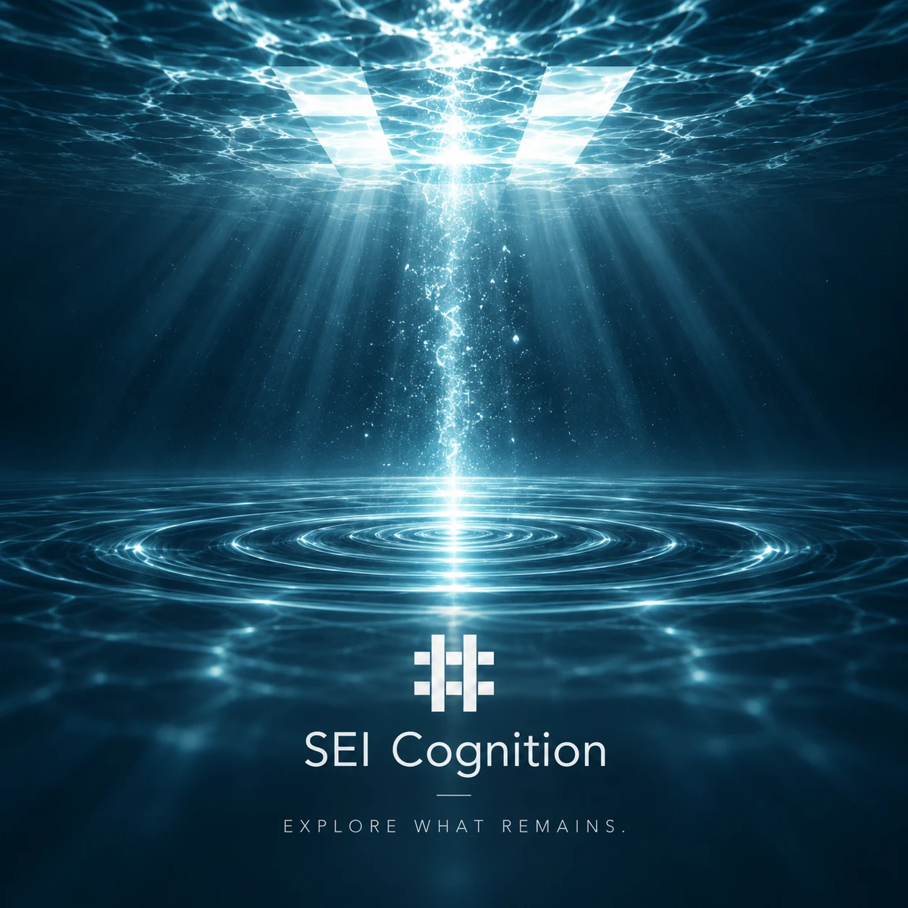

# 井（SEI Cognition）



> 重要: 本プロジェクトは、現在も生成AIを用いた開発中であり、人的レビューは不完全です。
>
> 実装・文書・安全性・利用手順の検証は完了していません。生成物をそのまま信頼したり、重要な判断に使用したりせず、利用前に人が内容と安全性を確認してください。外部利用者による検証も未実施です。

状態: **v0.2.0のローカル参照製品基準版を公開済み。開発は継続中**

SEI Cognitionは、**何を観測し、どう解釈し、何を根拠に判断したかを、後から確かめられるようにする基盤**です。人、AI、組織、利用するシステムが変わっても、当時の判断と未解決事項をたどれることを目指しています。

名前は易経の「井」に由来します。町や人の営みが変わっても井戸が残るという卦の像に、利用者や実行手段が変わっても判断の根拠を残すという考えを重ねています。

SEIは、AIエージェントを動かすための専用の実行基盤ではありません。意味の区別、不確実性、判断、責任に加え、能力（Capability）、来歴（Provenance）、意味の継承関係（Semantic Lineage）を扱います。

## なぜ意味を分けるのか

例えば、AIが資料を読んで「この案内を変更した方がよい」と提案しても、その提案が正式に採用されたとは限りません。採用されたとしても、実行が許可され、変更が行われ、期待した業務結果が得られたかどうかは、それぞれ別に確認する必要があります。

SEIでは、この違いを明示して保持します。

```text
Observation（観測）
  ≠ Interpretation / Hypothesis（解釈・仮説）
  ≠ Recommendation（推奨）
  ≠ Decision（決定）
  ≠ Authority（権限）
  ≠ Action Intent（実行意図）
  ≠ Execution（実行）
  ≠ Business Outcome（業務上の結果）
```

ほかにも、判断を誤って引き継がないために、次の区別を重視します。

| 区別 | 意味 |
| --- | --- |
| `Unknown != No` | 分からないことと、否定されたことは異なる |
| `not observed != unavailable` | 未観測と、利用できない状態は異なる |
| `not_verified != failed` | 未検証と、検証による不合格は異なる |
| `Conflict != latest-wins` | 新しい資料があるだけで食い違いは解消しない |
| `Matching != Decision` | 候補の一致は、意思決定ではない |
| `Capability != Provider` | 提供される能力と、その提供手段は異なる |
| `Capability Definition != Capability Observation` | 能力の定義と、実際の状態の観測は異なる |
| `Pattern != Cognitive Method` | 見いだしたパターンと、手順として定めた方法は異なる |
| `Method Application != Assurance` | 方法を適用した事実は品質保証ではない |
| `Logical Reference != Exact Historical Binding` | 論理的な参照と、特定版への歴史的な対応は異なる |
| `Projection != Canonical Semantic Authority` | 読みやすく整えた表示は、意味の正本ではない |
| `Requirement != Acceptance Scenario != Test Case` | 要求、受入の場面、個別の試験は異なる |
| `Semantic Contract != Representation Profile` | 意味の契約と表現形式の版は別に管理する |
| `Product access permission != semantic Responsibility / Authority` | 製品の操作権限と、意味上の責任・権限は異なる |

## 何を確認しているか

製品としての価値は、単一の点数ではなく次の8つの観点で評価します。

| 観点 | 確かめたいこと |
| --- | --- |
| V1 過去の判断の再構成 | 当時の根拠へ戻れるか |
| V2 意味の分離 | 推奨、決定、権限などを取り違えないか |
| V3 改訂の整合性 | 新しい情報で過去の記録を書き換えないか |
| V4 提供元からの独立性 | 特定のProviderに意味が依存しないか |
| V5 不確実性の保持 | 未解決事項を、そのまま次へ渡せるか |
| V6 人とAIからの可読性 | 双方が同じ正本を参照できるか |
| V7 段階的な明示化 | 必要に応じて意味を詳しく記述できるか |
| V8 実行手段からの独立性 | 実行手段を変えても意味が残るか |

正式な受入条件は[価値の受入基準](product/value/SEI_VALUE_ACCEPTANCE.md)、進捗との対応は[追跡資料](product/value/SEI_VALUE_TRACEABILITY.md)を参照してください。

## 意味の契約と実装

異なるシステムで同じ意味を交換・検証するため、必要な境界をSemantic Contractとして定義しています。現在の契約は次の5つです。

- `sei.semantic-reference/v1alpha1`
- `sei.decision-memory/v1alpha1`
- `sei.capability-observation/v1alpha1`
- `sei.cognitive-method/v1alpha1`
- `sei.semantic-interchange/v1alpha1`

意味をどのようなバイト列で表現し、同一性をどう検証するかは、別のRepresentation Profileで定義しています。現在は`sei.jcs+sha256/v1alpha1`と`sei.raw-bytes+sha256/v1alpha1`があります。詳細は[契約一覧](contracts/CONTRACT_CATALOG.md)を参照してください。

要求は`REQ-0001`〜`REQ-0023`、受入シナリオは`SCN-0001`〜`SCN-0019`を定義しています。新しい概念が現れるたびに契約を増やすのではなく、実装や提供元をまたいで意味を固定する必要がある場合に限って追加します。

限定した実行・検証の資産として、Goのsemantic runtime、JSON Schema・fixtureの検証器、Representation Verifier Registry、Provider Adapter、decision-memoryの再開、Cognitive Methodの型付き実行とモデル連携があります。実行環境・成果物・Providerを入れ替えて判断の来歴を確認するprobeや、製品として一連の操作を確認するharnessも整備しています。

これらはそれぞれ証拠が残る範囲で確認した能力です。**実行したことと、その結果の正しさ、継続運用、利用者への価値は別に評価します。**

## v0.2.0と現在の開発範囲

`v0.2.0`は、開発者・評価者が製品価値と意味の契約をローカルで確認するための**Local Reference Product Baseline**です。

| 項目 | 公開時点の識別情報 |
| --- | --- |
| tag | `v0.2.0` |
| source commit | `c3640bdfcc43652b63a5b9941fd6b472312ec28f` |
| Local Reference Package SHA-256 | `37f34d3ae4885df655e889f2799b9aea1d8c7c8c060c207df83f50459431ef17` |

この版では、同じsource commitに対して要求、契約、runtime、検証結果、配布assetを照合したRelease Evidenceを残しています。[release/v0.2.0/](release/v0.2.0/)に当時の受入範囲と証拠があります。

**このRelease Evidenceは本番運用や実際の利用者による受入を示しません。** 以後のcommitにも、過去の検証結果を自動的に適用しません。検証していないことは`Not Yet Verified`として残します。

現在のmainにある`sei` CLI(`gate`・`mcp`を含む。使い方は[QUICKSTART](runtime/go/cmd/sei/QUICKSTART.md))は、v0.2.0のRelease Evidenceの対象外です。v0.2.0のtagには`runtime/go/seicli`と`runtime/go/cmd/sei`が含まれません。現在のmainの`sei`を版固定で入手する経路と、次のreleaseとして扱うかは未決です(Issue #688)。

GitHub Actionsは当面停止しており、必要な検査は変更範囲に応じてローカルで実行する方針です。手順は[開発ワークフロー](plan/DEVELOPMENT_WORKFLOW.md)にあります。

## TEIとの関係

鼎（TEI）は、SEIから利用できる業務Capability Providerの一つです。SEIは観測・解釈・判断の意味と来歴を扱い、TEIは業務Capabilityを実現する手段となり得ます。

関連製品という理由だけでTEIに優先的な信頼や権限を与えたり、TEI固有のApplication・Database・Deployment構造をSEIの意味の契約へ取り込んだりはしません。

## リポジトリを読む順序

| 読みたいこと | 入口 |
| --- | --- |
| 製品の目的と価値 | [product/README.md](product/README.md) |
| 要求と受入シナリオ | [requirements/README.md](requirements/README.md) |
| 構成と責務 | [architecture/README.md](architecture/README.md) |
| Semantic Contractと表現形式 | [contracts/README.md](contracts/README.md) |
| 評価と探索 | [evaluation/](evaluation/) |
| `sei` CLIを使う(記録・再開・gate・MCP) | [runtime/go/cmd/sei/QUICKSTART.md](runtime/go/cmd/sei/QUICKSTART.md) |
| Go実装と検証 | [runtime/](runtime/)・[tools/](tools/) |
| Releaseの証拠 | [release/README.md](release/README.md) |
| 現在の計画・ADR | [plan/](plan/) |

文書の目的・要求・契約・実装・検証結果には、それぞれ異なる役割があります。下位の実装結果によって、上位の意味が自動的に決まるわけではありません。

ADRとIssueの登録状況は`plan/registry.yaml`、文書ごとの状態は各文書本文を正とします。日本語文書の作成方針は[文書作成基準](plan/DOCUMENT_AUTHORING_STANDARD.md)にあります。脆弱性の報告は[SECURITY.md](SECURITY.md)、変更の進め方は[CONTRIBUTING.md](CONTRIBUTING.md)を参照してください。

## ライセンス

[MIT](LICENSE)
